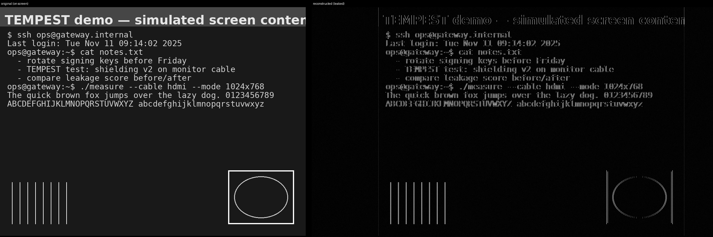

# TEMPEST / Deep-TEMPEST Visualizer

A cross-platform, **education- and defense-oriented** toolkit for understanding
how the raster signal driving an HDMI/DVI display unintentionally radiates
("compromising emanations" — the phenomenon behind *TEMPEST* / *Van Eck
phreaking* / the academic *Deep-TEMPEST* work), and how that leakage is
modeled, reconstructed, and — the point — **reduced**.

It runs on Windows, macOS and Linux. The core and CLI need only `numpy` and
`Pillow`; the GUI adds Tkinter (bundled with Python on Windows/macOS).



> Left: what is on screen. Right: the frame a receiver reconstructs purely from
> the leaked signal. Flat areas vanish; **edges and text radiate** — which is
> exactly why the reconstruction looks like a ghost, and why the countermeasures
> below target high spatial frequencies.

---

## What this is — and is not

**This is** a transparent simulator and analysis tool for learning the signal
theory, for self-assessing equipment **you own or are explicitly authorized to
test**, and for measuring how well countermeasures work.

**This is not** an interception tool. It ships a *forward model* (simulate
leakage from an image you supply) and a *reconstruction* stage that works on IQ
files. It contains **no** targeting, victim-tuning, scanning, device
fingerprinting, or detection-evasion functionality, and none will be added.

> ⚠️ **Legal note.** Intercepting the electromagnetic emanations of equipment you
> do not own or are not authorized to test is illegal in most jurisdictions
> (wiretap / unauthorized-interception statutes). The optional live-capture path
> is gated behind an explicit authorization acknowledgement for this reason. You
> are responsible for operating lawfully. See [`ETHICS.md`](ETHICS.md).

---

## Install

```bash
git clone <this repo> && cd hdmi-leaker
python -m pip install -r requirements.txt      # numpy + Pillow
# or install as a package (adds the `tempest-visualizer` command):
python -m pip install -e .
```

Linux GUI users also need Tk: `sudo apt install python3-tk` (Debian/Ubuntu).
Optional live capture: install SoapySDR + your SDR driver, then `pip install
SoapySDR` (extra: `pip install -e ".[sdr]"`).

No install is required to try it — just run `python -m tempest_visualizer ...`
from the repo root.

## Quick start

```bash
# List the display timings the model knows about
python -m tempest_visualizer modes

# End-to-end on a synthetic "screen": image -> emanation -> blind reconstruction
python -m tempest_visualizer demo --mode 1024x768@60 --snr 18 --out demo.png

# Use your own screenshot as the on-screen content
python -m tempest_visualizer demo --image my_screen.png --mode 1920x1080@60 --out demo.png

# Measure a countermeasure (TEMPEST-safe-font style low-pass)
python -m tempest_visualizer countermeasure --mode 1024x768@60 --snr 12 --cutoff 0.10

# Live feed: capture YOUR OWN screen, simulate leakage, reconstruct — in a loop
python -m tempest_visualizer live --mode 1024x768@60 --snr 16
#   (install 'mss' for real screen capture; otherwise an animated synthetic
#    screen is used so it still runs on a headless box)

# Launch the graphical visualizer (needs Tk); has a "Live ▶" button
python -m tempest_visualizer gui
```

### Live feed — what it captures

The frames that become your monitor's HDMI output are your machine's
*framebuffer*. The `live` command (and the GUI's **Live ▶** button) grab that
framebuffer — an ordinary screen capture of **the machine it runs on** — and
push each frame through the forward model + reconstruction so you watch the
ghost update as your screen changes.

This is screen mirroring into the simulator. It does **not** read an HDMI cable
or pull a picture out of the air, and it only ever sees its own host's display.
To work with the *actual electromagnetic emanations* of equipment **you own or
are authorized to test**, record IQ with an SDR (see `capture`) and feed it to
`reconstruct`.

Separate the stages when working from recorded IQ:

```bash
python -m tempest_visualizer simulate --mode 800x600@60 --snr 15 --out leak.cf32
python -m tempest_visualizer reconstruct leak.cf32 --mode 800x600@60 --out ghost.png
```

## How it works

1. **Timing** (`timing.py`) — every video mode sends visible pixels *plus*
   horizontal/vertical blanking. That blanking gives the leaked signal its
   precise periodicity, which is the key the reconstructor locks onto.

2. **Forward model** (`emanation.py`) — the cable radiates *transitions*, not DC
   levels. We high-pass (difference) the scan-order pixel stream, modulate it
   onto a carrier (with optional frequency offset / phase noise), and add a
   noise floor. Output is a complex64 IQ stream, just like an SDR would record.

3. **Reconstruction** (`reconstruct.py`) — with no knowledge of the source
   image: autocorrelation finds the samples-per-line and lines-per-frame, the
   1-D magnitude stream is folded into a 2-D frame, and a global de-skew stops
   it rolling. The only prior is "video is a periodic raster."

4. **Countermeasures** (`countermeasures.py`) — a low-pass filter approximating
   a TEMPEST-safe font (Kuhn & Anderson, 1998). Against a **fixed** noise floor
   it removes 8–20 dB of emanation power, so the reconstruction degrades. The
   tool reports the effective-SNR drop (deterministic) and a reconstruction
   legibility score.

5. **IQ I/O** (`iqio.py`) — reads/writes the common SDR formats: interleaved
   float32 (`.cf32`/`.fc32`, GNU Radio / SoapySDR "CF32"), int16 (`.cs16`),
   int8 (`.cs8`), and `.npy`.

6. **Optional capture** (`capture.py`) — a minimal, generic SoapySDR reader for
   authorized self-assessment, gated behind `--i-am-authorized`.

## Project layout

```
tempest_visualizer/
  timing.py          display timings (CEA-861 / VESA DMT)
  emanation.py       forward model: image -> IQ
  reconstruct.py     blind reconstruction: IQ -> ghost frame
  countermeasures.py low-pass mitigation + leakage metrics
  iqio.py            SDR IQ file formats
  synthetic.py       generate test "screen" images
  livefeed.py        live screen-capture source + per-frame processing
  capture.py         optional SoapySDR live capture (authorized self-test)
  cli.py / gui.py    command line + Tkinter GUI
tests/               pytest round-trip and physics-invariant tests
```

## Tests

```bash
python -m pip install pytest
python -m pytest -q
```

## Background & further reading

- W. van Eck, *Electromagnetic Radiation from Video Display Units* (1985)
- M. Kuhn & R. Anderson, *Soft Tempest: Hidden Data Transmission Using
  Electromagnetic Emanations* (1998) — origin of TEMPEST-safe fonts
- M. Kuhn, *Compromising emanations* (PhD thesis, Cambridge, 2003)
- `gr-tempest` (GNU Radio) and the **Deep-TEMPEST** project (Fac. de Ingeniería,
  UdelaR, 2024) — deep-learning HDMI emanation reconstruction

This toolkit is a teaching reimplementation of the *ideas* in that line of work;
it is not affiliated with those projects and uses its own simplified model.

## License

MIT — see [`LICENSE`](LICENSE). Use it to learn and to defend your own systems.
